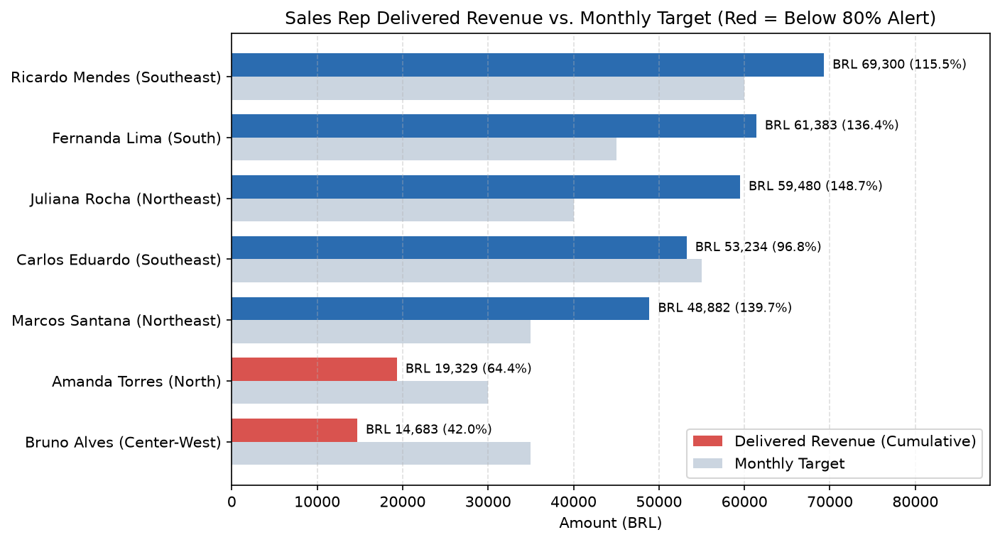
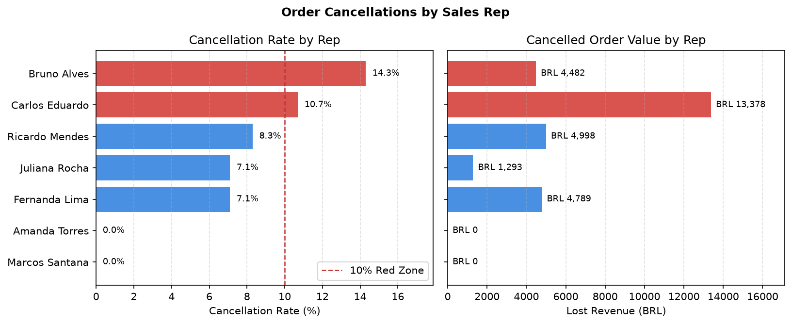
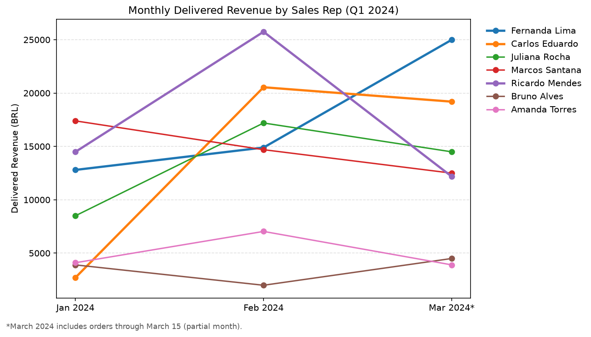

# TechStore — Sales Team Performance Dashboard

[](https://github.com/NickNunes26/datamundo-practice/actions/workflows/ci.yml)

Executive SQL analysis of TechStore's commercial team performance, built for a board-level review covering rep rankings, target attainment, category mix, customer concentration, cancellation risk, regional product champions, and Q1 2024 monthly trends.

This project started as an exercise from the DataMundo *SQL for Data Analysis* track and was refactored into a self-contained local workflow using DuckDB, pandas, matplotlib, and pytest. The raw synthetic seed (`SQL/seed_techstore.sql`) stays untouched in Portuguese, while an English semantic view layer (`SQL/views_en.sql`) translates table names, columns, and categorical labels for reporting.

## Questions Covered

1. **Overall sales rep ranking** — `RANK()` window function and `LEFT JOIN` comparing delivered orders, revenue, average ticket, and target attainment across all 7 reps.
2. **Category mix for top 3 reps** — CTE + 4-table `JOIN` breaking down units and revenue by category for the highest-grossing reps.
3. **Top 5 customers per rep** — `ROW_NUMBER() OVER (PARTITION BY sales_rep)` to surface key accounts and customer concentration risk.
4. **Cancellation rate by rep** — Conditional aggregation + `HAVING > 10%` red-zone alert tracking lost revenue and cancellation share.
5. **Top 3 champion products by region** — `ROW_NUMBER() OVER (PARTITION BY region)` identifying regional best-sellers.
6. **Q1 2024 monthly revenue evolution** — Pivoted Jan/Feb/Mar 2024 delivered revenue per rep to track momentum.
7. **Under-80% target alert** — `GROUP BY ... HAVING` isolating reps who need an immediate pipeline and coaching plan.

## Key Findings

- **Top performers:** `Ricardo Mendes` (BRL 69,300.30, 26 orders), `Fernanda Lima` (BRL 61,382.60, 21 orders), and `Juliana Rocha` (BRL 59,480.00, 20 orders) lead total delivered revenue. `Juliana Rocha` posts the highest average ticket (BRL 2,974.00) and target ratio (148.7%).
- **Under-80% alert & account concentration:** `Bruno Alves` (42.0% of monthly target, BRL 14,682.90) and `Amanda Torres` (64.4%, BRL 19,329.00) are the only reps below 80%. Both serve only **2 delivered customers** each — Amanda relies on `Prefeitura Regional AM` for 87.9% of her revenue, while Bruno serves only 2 Retail accounts.
- **Cancellation red zone (> 10%):** `Bruno Alves` leads in cancellation rate (**14.3%**, 2 of 14 orders, BRL 4,482.10 lost), while `Carlos Eduardo` (**10.7%**, 3 of 28 orders) accounts for **BRL 13,378.00** in lost value — **46.2%** of TechStore's total cancelled revenue. `Marcos Santana` and `Amanda Torres` have **0.0%** cancellations.
- **Q1 momentum:** `Fernanda Lima` accelerated every month (BRL 12,796.90 → BRL 14,894.90 → **BRL 24,994.80** through March 15 alone). `Carlos Eduardo` rebounded sharply from Jan (BRL 2,698.00) to Feb (BRL 20,544.90) and mid-Mar (BRL 19,195.80).
- **Regional champions & cross-sell:** `Southeast` is Laptop-dominated (`Notebook Gamer Z5` at BRL 31,596.00), `Northeast` leads in `Smartphone Galaxy Ultra` (BRL 23,093.00), and top reps have room to bundle high-margin `Accessories` into hardware deals.

### Visuals







## Project Structure

```text
.
├── SQL/
│   ├── seed_techstore.sql             # Raw schema and seed data (PT-BR)
│   └── views_en.sql                   # English semantic / i18n views
├── docs/
│   ├── rep_ranking_vs_target.png      # Chart: delivered revenue vs. target & alert
│   ├── cancellations_by_rep.png       # Chart: cancellation rate & lost revenue
│   └── monthly_evolution_by_rep.png   # Chart: Q1 2024 monthly trend per rep
├── tests/
│   └── test_dashboard.py              # View parity & dashboard query invariant tests
├── team_performance_dashboard.ipynb   # Main executed analysis notebook
├── requirements.txt
├── .gitignore
└── README.md
```

## Setup

```bash
python -m venv .venv
source .venv/bin/activate        # Windows: .venv\Scripts\activate
pip install -r requirements.txt
jupyter notebook team_performance_dashboard.ipynb
```

Run all cells from top to bottom. The setup cell loads `SQL/seed_techstore.sql` and `SQL/views_en.sql` into an in-memory DuckDB instance and defines a `sql()` helper returning pandas DataFrames.

## Tests

```bash
pytest -v
```

Verifies row-count parity between raw tables and English views, plus core business-logic invariants (all 7 reps ranked, regional top-3 cap, cancellation > 10% alert, and < 80% target alert). Also runs automatically via GitHub Actions on push to `main`.
