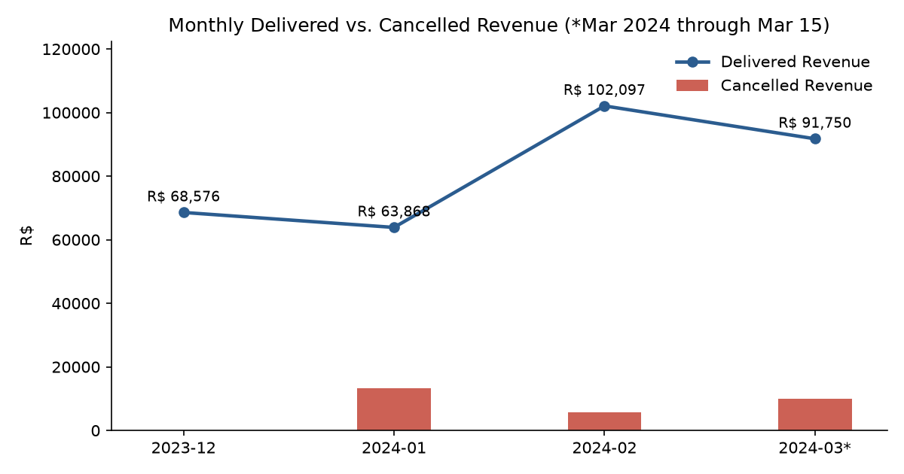

# TechStore First Week Report

[](https://github.com/NickNunes26/techstore-first-week-report/actions/workflows/ci.yml)

SQL analysis of a fictional Brazilian electronics retailer (**TechStore**), built around a first-week reporting scenario covering products, inventory, customers, orders, sales targets, and category margins.

This project started as an exercise from the DataMundo *SQL for Data Analysis* track and was refactored to run locally using DuckDB, pandas, and matplotlib. The raw synthetic seed (`SQL/seed_techstore.sql`) stays untouched in Portuguese, while a SQL view layer (`SQL/views_en.sql`) translates table names, columns, and categorical labels into English for reporting.

## Questions Covered

**Initial report (filtering & sorting)**
1. **Product catalog** — Full product list grouped by category and sorted by price.
2. **Low stock alert** — Products with fewer than 15 units remaining.
3. **Customer distribution** — Overview of the customer base ordered by state.
4. **Government accounts** — Customers in the `Government` segment.
5. **Top 10 orders** — Largest orders recorded by total value.
6. **Cancelled orders** — Cancelled orders sorted by value and payment method.
7. **Sales targets** — Sales reps with monthly targets above R$ 50,000.

**Deeper analysis (`JOIN`s & aggregations)**
8. **Delivered revenue by sales rep** — Total and monthly average delivered revenue vs. `monthly_target`.
9. **Cancellation rate by payment method** — Order volume vs. lost revenue across `Card`, `Bank Slip`, and `Instant Transfer`.
10. **Gross margin by category** — Average margin and retail inventory value per category.
11. **Zero-sale products** — Catalog items with no recorded line items in `order_items`.
12. **Monthly revenue trend** — Month-over-month delivered vs. cancelled revenue using a CTE and `LAG` window function.

## Key Findings

- **Inventory risk:** 3 products are below 15 units — `Monitor UltraWide 34"` (5), `Notebook Gamer Z5` (8), and `Workstation W3` (12). All three are high-ticket items (R$ 2,599 to R$ 7,899) and should be prioritized for restocking.
- **Cancellations:** 12 orders were cancelled, totaling R$ 28,940.00. `Card` accounts for the highest lost value (5 orders, R$ 18,476.00), while `Bank Slip` has the highest cancellation rate at **16.7%** (4 of 24 orders) — roughly 3x the rate of `Card` (5.9%) and `Instant Transfer` (5.3%).
- **Pending high-value orders:** 2 of the top 10 orders (`#91` at R$ 8,799.00 and `#155` at R$ 6,480.00) are still `Pending` and worth following up before they expire or cancel.
- **Monthly trend:** Delivered revenue rose **+59.9%** in Feb 2024 (R$ 102,096.60). Mar 2024 already reached R$ 91,750.20 (36 delivered orders) with data only through March 15.
- **Sales rep performance:** `Ricardo Mendes` (R$ 69,300.30), `Fernanda Lima` (R$ 61,382.60), and `Juliana Rocha` (R$ 59,480.00) lead total delivered revenue across the 4-month window. Monthly averages sit below 40% of `monthly_target` for all 7 reps.
- **Margins & dead stock:** `Accessories` has the highest average gross margin (56.4%) vs. `Laptops` (34.6%). 5 catalog items have zero recorded sales, led by `Notebook Essencial E2` (R$ 112,495.50 in stock) and `Tablet Essencial 8"` (R$ 47,960.00).

### Visuals




## Data Model & i18n Layer

The raw tables from [`SQL/seed_techstore.sql`](SQL/seed_techstore.sql) are mapped into English reporting views in [`SQL/views_en.sql`](SQL/views_en.sql) (translating column names plus `category`, `segment`, `region`, `status`, and `payment_method` values):

| Raw Table | English View | Rows | Description |
|-----------|--------------|------|-------------|
| `produtos` | `products` | 23 | Product catalog, pricing, cost, and current stock |
| `clientes` | `customers` | 47 | Customers across Retail, Corporate, and Government |
| `vendedores` | `sales_reps` | 7 | Sales team, region, hire date, and monthly target |
| `pedidos` | `orders` | 165 | Orders from Dec 2023 to Mar 2024 (Delivered, In Transit, Pending, Cancelled) |
| `itens_pedido` | `order_items` | 182 | Line items linking orders to products |

## Project Structure

```text
.
├── .github/workflows/
│   └── ci.yml                        # Runs pytest on push / PR
├── SQL/
│   ├── seed_techstore.sql            # Raw schema and seed data (PT-BR)
│   └── views_en.sql                  # English semantic / i18n views
├── docs/
│   ├── monthly_revenue.png           # Chart: monthly delivered vs. cancelled revenue
│   ├── revenue_by_rep.png            # Chart: delivered revenue by rep
│   └── cancellations_by_payment.png  # Chart: cancellation rate and value
├── tests/
│   └── test_data.py                  # Row counts, i18n mapping, FK & bounds checks
├── first_week_report.ipynb           # Main analysis notebook
├── requirements.txt
├── .gitignore
└── README.md
```

## Setup

```bash
python -m venv .venv
source .venv/bin/activate        # Windows: .venv\Scripts\activate
pip install -r requirements.txt
jupyter notebook first_week_report.ipynb
```

Run all cells from top to bottom. The setup cell loads `SQL/seed_techstore.sql` and `SQL/views_en.sql` into an in-memory DuckDB instance and defines a `sql()` helper that returns pandas DataFrames.

## Tests

```bash
pytest -v
```

Checks row-count parity between raw tables and English views, verifies all categorical values are translated, and validates foreign keys and numeric bounds. Also runs automatically via GitHub Actions on push to `main`.
